# NVL72 Data Flows: C2C, MNNVL, and RDMA

**Scope:** How data moves inside and between **GB200 / GB300 NVL72** racks across the three fabrics — NVLink-C2C (chip-to-chip), Multi-Node NVLink (MNNVL, the in-rack scale-up fabric), and RDMA (the cross-rack scale-out fabric). Framed for benchmarking (NCCL tests) and pre-training workloads. All performance figures and NCCL guidance are GB200/GB300 unless noted. <!-- INTERNAL_START -->A Vera Rubin node diagram is included in Section 3a for architectural reference only.<!-- INTERNAL_END -->

**Audience:** HW/SW/network engineers.

---

## 1. The three fabrics at a glance

| Fabric | Role | Scope (domain) | Per-GPU BW — theoretical vs **measured** | Coherence | Who drives it |
|---|---|---|---|---|---|
| **NVLink-C2C** | Moves data across the **device↔host domain boundary** (Blackwell GPU ↔ Grace CPU) inside a superchip | 1 Grace + 2 Blackwell (a GB200/GB300 superchip) | **~200 GB/s/direction per GPU** (measured on GB300 with `nvbandwidth`) | Cache-coherent, unified memory | HW / driver (transparent) |
| **MNNVL (NVLink 5 + NVSwitch)** | GPU ↔ GPU **scale-up** | **72 GPUs** = 1 NVLink domain (one rack) | 18 links/GPU = **900 GB/s per direction** (1.8 TB/s bidirectional, GB200/GB300); measured busBW **>900 GB/s all-reduce / ~600 GB/s all-to-all** (NCCL Tests, in-rack) | Load/store + P2P, non-coherent | NCCL P2P / NVLS |
| **RDMA (InfiniBand or RoCE)** | GPU ↔ GPU **scale-out** | Across racks → SuperPOD / cluster | GB200: **400 Gb/s (50 GB/s)** · GB300: **800 Gb/s (100 GB/s)** line rate | Message-passing, GPUDirect RDMA | NCCL NET transport |

> **Key caveat on C2C.** C2C is what data crosses when it moves out of the GPU's **device domain** and into the **host domain** — the Grace CPU and its LPDDR5X. The physical link is NVLink-class (fast), but it is **not** a direct GPU-to-GPU data path: every transfer leaves device memory, lands in host memory, and is CPU-mediated. The C2C link runs at **~200 GB/s per direction** per GPU (measured on GB300 with `nvbandwidth`) — that is the link's design point, working as intended. It is a **separate path** from the NVLink GPU-to-GPU fabric, not a slower version of it. Treat C2C as a moderate-bandwidth device↔host link, not a high-bandwidth memory tier. <!-- INTERNAL_START -->*(Source: NVIDIA Internal.)*<!-- INTERNAL_END -->

---

## 2. Diagram 1 — Topology: one NVL72 rack + scale-out

Shows all three fabrics in one picture: **C2C** inside each superchip, **MNNVL** binding all 72 GPUs through the NVSwitch backplane, and **RDMA** leaving the rack through per-GPU SuperNICs to the spine.

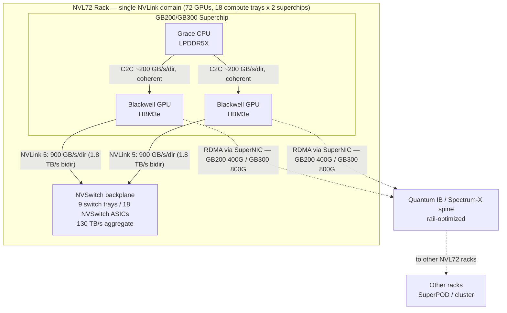

**Read it as three concentric scopes:** intra-superchip (C2C) ⊂ intra-rack (MNNVL) ⊂ inter-rack (RDMA).

---

<!-- INTERNAL_START -->
## 3. Diagram — Superchip component detail (PCIe, NICs, NVMe, management)

One node contains **two superchips** (each a Grace CPU + 2 Blackwell GPUs), connected by 6× Clinks (~150 GB/s). GB200 and GB300 share the same Grace+Blackwell+NVLink topology but differ in NIC generation, NVMe attachment point, and RDMA path to the GPU (see Section 6).

### GB200 node

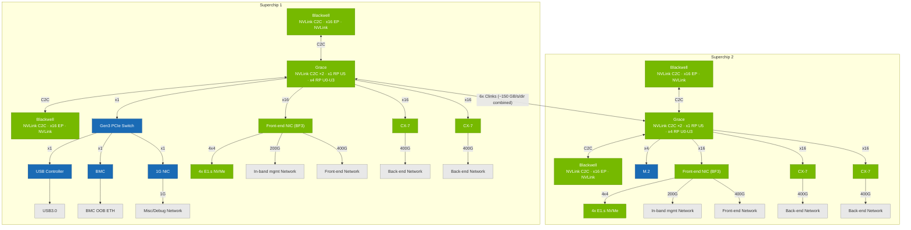

### GB300 node

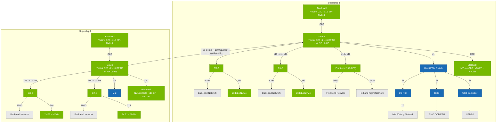

**Key observations (both generations):**
- **Superchip 1** owns the management chain in both: Gen3 PCIe switch → USB controller / BMC / 1G NIC, plus the front-end BF3 NIC. Both BF3 ports are 400G-capable; speeds shown reflect the SuperPOD configuration and actual deployment may vary.
- **NVMe attachment differs:** GB200 attaches 4× E1.s NVMe to the BF3 front-end NIC (4×4). GB300 attaches 2× E1.s NVMe to each CX-8 SuperNIC (2×4 per NIC).
- **Back-end NICs:** GB200 has two CX-7s at 400G each per superchip (4 per node). GB300 has two CX-8 SuperNICs at 800G each per superchip (4 per node).
- **RDMA path differs:** GB300/CX-8 has a direct Blackwell↔CX-8 connection (true GPUDirect RDMA). GB200/CX-7 routes via Grace (C2C → Grace crossbar → PCIe → CX-7); see Section 6.
- **Superchip 2** adds an M.2 slot (x4) for local OS/boot storage in both generations.
- C2C is strictly intra-superchip; the inter-superchip path is the **6× Clinks** between Grace CPUs (~150 GB/s per direction combined across all six links — roughly 25 GB/s/dir per link).

---

## 3a. Vera Rubin node topology — architectural reference

> **Out of scope for this document.** The diagram below is included solely to show how the next-generation platform relates to GB200/GB300 at the node level. Figures, NCCL guidance, and fabric analysis throughout are GB200/GB300 only.

One Vera Rubin node = two superchips. Each superchip is one **Vera CPU** flanked by two **Rubin GPUs** connected via NVLink-C2C (same concept as Grace + Blackwell in GB200/GB300). The two Vera CPUs within the node are linked by **NV-CLINK (x8)**, the successor to the 6× Clinks used between Grace CPUs. Each Vera drives **4× ConnectX-9 (CX-9)** NICs via PCIe Gen6 x16 for the E/W (back-end / scale-out) fabric, and both Vera CPUs share a single **BF4-800G** front-end NIC for the N/S (management / front-end) network.

**RDMA path on Vera Rubin:** the CX-9 NICs attach to **Vera (CPU)**, not directly to the Rubin GPUs. The RDMA data path is **Rubin GPU → NVLink-C2C → Vera CPU crossbar → PCIe Gen6 → CX-9** — the same indirect architecture as GB200/CX7, not the direct GPU↔NIC path of GB300/CX8.

```mermaid
flowchart TB
    classDef nvidia fill:#76b900,color:#fff,stroke:#5a8c00
    classDef mgmt   fill:#1a6bb5,color:#fff,stroke:#145090
    classDef ext    fill:#e8e8e8,color:#333,stroke:#999

    subgraph SC1["Superchip 1"]
        direction TB
        RL1["Rubin GPU<br/>NVLink-C2C · Gen6 x2 EP"]:::nvidia
        V1["Vera CPU<br/>NVLink-C2C ×2 · Gen6 x2 RP ×2<br/>Gen6 x16 ×4 · Gen6 x8 (BF4)"]:::nvidia
        RR1["Rubin GPU<br/>NVLink-C2C · Gen6 x2 EP"]:::nvidia
        RL1 <-->|"NVLink-C2C"| V1
        V1  <-->|"NVLink-C2C"| RR1

        CX9A["CX-9"]:::nvidia
        CX9B["CX-9"]:::nvidia
        CX9C["CX-9"]:::nvidia
        CX9D["CX-9"]:::nvidia
        V1 -->|"Gen6 x16"| CX9A
        V1 -->|"Gen6 x16"| CX9B
        V1 -->|"Gen6 x16"| CX9C
        V1 -->|"Gen6 x16"| CX9D

        NVM1["E1.s NVMe"]:::nvidia
        NVM2["E1.s NVMe"]:::nvidia
        CX9A -->|"Gen6 x4"| NVM1
        CX9C -->|"Gen6 x4"| NVM2

        MGMT1["USB Bridge / BMC<br/>Utility NIC"]:::mgmt
        V1 -->|"Gen2 x1"| MGMT1
        OOB1["USB3.0 / 1G RJ-45"]:::ext
        MGMT1 --> OOB1

        EW1["E/W Network — 1.6T OSFP"]:::ext
        EW2["E/W Network — 1.6T OSFP"]:::ext
        CX9A -->|"4×200G"| EW1
        CX9B -->|"4×200G"| EW1
        CX9C -->|"4×200G"| EW2
        CX9D -->|"4×200G"| EW2
    end

    subgraph SC2["Superchip 2"]
        direction TB
        RL2["Rubin GPU<br/>NVLink-C2C · Gen6 x2 EP"]:::nvidia
        V2["Vera CPU<br/>NVLink-C2C ×2 · Gen6 x2 RP ×2<br/>Gen6 x16 ×4 · Gen6 x8 (BF4)"]:::nvidia
        RR2["Rubin GPU<br/>NVLink-C2C · Gen6 x2 EP"]:::nvidia
        RL2 <-->|"NVLink-C2C"| V2
        V2  <-->|"NVLink-C2C"| RR2

        CX9E["CX-9"]:::nvidia
        CX9F["CX-9"]:::nvidia
        CX9G["CX-9"]:::nvidia
        CX9H["CX-9"]:::nvidia
        V2 -->|"Gen6 x16"| CX9E
        V2 -->|"Gen6 x16"| CX9F
        V2 -->|"Gen6 x16"| CX9G
        V2 -->|"Gen6 x16"| CX9H

        NVM3["E1.s NVMe"]:::nvidia
        NVM4["E1.s NVMe"]:::nvidia
        CX9E -->|"Gen6 x4"| NVM3
        CX9G -->|"Gen6 x4"| NVM4

        SSD2["E1.S Boot SSD"]:::mgmt
        V2 -->|"Gen5 x4"| SSD2

        EW3["E/W Network — 1.6T OSFP"]:::ext
        EW4["E/W Network — 1.6T OSFP"]:::ext
        CX9E -->|"4×200G"| EW3
        CX9F -->|"4×200G"| EW3
        CX9G -->|"4×200G"| EW4
        CX9H -->|"4×200G"| EW4
    end

    BF4["N/S NIC — BF4-800G<br/>(Vera + CX9)"]:::nvidia
    V1 -->|"Gen6 x8"| BF4
    V2 -->|"Gen6 x8"| BF4
    NS1["N/S Network — 400G"]:::ext
    NS2["N/S Network — 400G"]:::ext
    BF4 --> NS1
    BF4 --> NS2

    V1 <-->|"NV-CLINK (x8)"| V2
```

**Key observations vs GB200/GB300:**
- **RDMA path is indirect** — CX-9 connects to Vera (CPU) via Gen6 x16, same as GB200/CX7 architecture (not the direct Blackwell↔CX8 path of GB300).
- **4× CX-9 per Vera** (8 per node) vs 2× CX-8 per Grace (4 per node in GB300); each CX-9 provides 4×200G (800G) to the E/W fabric.
- **NV-CLINK (x8)** replaces the 6× Clinks inter-CPU link used in GB200/GB300.
- **PCIe Gen6** throughout (vs Gen5 in GB300).
- **BF4-800G** replaces BF3 as the front-end N/S NIC; Rubin also adds a Gen6 x2 PCIe endpoint back to Vera (not present on Blackwell).
- Management and NVMe attachment pattern mirrors GB200/GB300 (off the CPU-side PCIe tree).
<!-- INTERNAL_END -->

---

## 4. NVLink-C2C — the device↔host path

- **What it connects:** the Grace CPU to its 2 Blackwell GPUs *within one superchip*. It is **not** a GPU-to-GPU path — every transfer is mediated by the Grace CPU and terminates in LPDDR5X.
- **Bandwidth:** the C2C link runs at **~200 GB/s per direction** per GPU (measured on GB300 with `nvbandwidth`) — that is the link's design point. It is faster than PCIe Gen5 x16 (~64 GB/s peak), but it is a **separate path** from the NVLink GPU-to-GPU fabric, so **do not treat Grace LPDDR5X as a fast memory tier** the way HBM or NVLink peers behave.
- **Coherence:** hardware cache-coherent. CPU and GPU share a single address space (unified memory); either side can reference the other's memory with load/store semantics, no explicit copy required — but bandwidth is capped by the ~200 GB/s/direction C2C ceiling above.
- **When it comes into play:**
  - Staging/prefetch of training data, optimizer state, and parameters from Grace LPDDR5X into HBM3e.
  - CPU-side offload (e.g., optimizer states, activations, KV-cache spill) where HBM capacity is the constraint — **but this is bandwidth-limited by C2C**; offloading hot state to Grace can bottleneck a step at the C2C link's ~200 GB/s/direction, which is a different (and lower) path than the NVLink GPU-to-GPU fabric.
  - Any `cudaMemcpy`/UVM traffic between host and device — rides C2C, not PCIe.
- **Benchmarking note:** C2C does **not** appear in a GPU-to-GPU NCCL bus-bandwidth number. Measure it separately (host↔device bandwidth tests, or unified-memory microbenchmarks). GB300 reference point (`nvbandwidth`): **~200 GB/s per direction** per GPU. If a data-loader or offload path is bottlenecked, this ~200 GB/s/direction C2C ceiling is the thing to check — it is a separate path from the NVLink GPU-to-GPU number, not a slower version of it.

---

## 5. MNNVL — the in-rack scale-up fabric

- **What it connects:** all **72 GPUs** in the rack into **one flat NVLink domain** via the NVSwitch backplane. Any GPU reaches any other GPU at full NVLink bandwidth in one switch hop.
- **Bandwidth:** each GPU has **18 NVLink 5 links** (GB200/GB300), giving **900 GB/s per direction** (1.8 TB/s bidirectional) per GPU; **130 TB/s** NVSwitch backplane aggregate. Measured GB300 busBW (NCCL Tests AllReduce / AlltoAll): **>900 GB/s all-reduce / ~600 GB/s all-to-all** in-rack (72 GPUs).
- **Topology:** 9 NVSwitch trays, 18 NVSwitch ASICs, copper backplane; each GPU has one link to each in-rack switch plane.
- **Semantics:** direct GPU load/store and P2P copy across the domain; **not** cache-coherent like C2C, but far higher bandwidth and lower latency than RDMA. Supports **NVLink SHARP (NVLS)** — in-network reduction executed in the NVSwitch, which offloads collectives (all-reduce, reduce-scatter, all-gather) from the GPUs.
- **When it comes into play:**
  - The bandwidth-hungry collectives of a pre-training step: tensor-parallel (TP) all-reduce/all-gather, expert-parallel (EP) all-to-all, sequence/context-parallel exchanges.
  - Any parallelism dimension you want to keep *inside* the 72-GPU domain because it exchanges the most bytes per step.
- **Benchmarking note:** In-rack NCCL collectives should ride NVLink/NVLS and report the highest busbw you'll see. Confirm NVLS is engaged (`NCCL_NVLS_ENABLE=1`, and NCCL ≥ the version that supports Blackwell NVLS) and that no unexpected hop is falling back to net.

---

## 6. RDMA — the cross-rack scale-out fabric

- **What it connects:** GPUs in *different* racks, extending communication beyond the 72-GPU NVLink domain into a SuperPOD/cluster.
- **NIC / bandwidth per GPU:**
  - **GB200:** ConnectX-7, **400 Gb/s (NDR)** per GPU — Quantum-2 InfiniBand or Spectrum-X Ethernet.
  - **GB300:** ConnectX-8 SuperNIC, **800 Gb/s** per GPU — Quantum-X800 InfiniBand or Spectrum-X.
- **GPUDirect RDMA — path differs by generation:**
  - **GB300 (CX8):** the CX8 SuperNIC is **directly connected to the Blackwell GPU**, so the NIC DMAs straight to/from HBM, bypassing C2C and Grace entirely. This is true GPUDirect RDMA.
  - **GB200 (CX7):** there is no direct GPU↔NIC connection. RDMA traffic traverses **GPU → NVLink-C2C → Grace CPU crossbar → PCIe → CX7**. CX7 does not support GPUDirect RDMA on this architecture; traffic goes through the Grace crossbar rather than directly to HBM. The NIC line rate (400 Gb/s = 50 GB/s) is well below the C2C ceiling (~200 GB/s/direction), so C2C is not the bandwidth bottleneck, but the path is indirect and the latency/CPU-overhead profile differs from the GB300 direct path.
  - **Vera Rubin (CX-9, reference):** same indirect architecture as GB200 — Rubin GPU → NVLink-C2C → Vera CPU crossbar → PCIe Gen6 → CX-9. CX-9 attaches to Vera (CPU), not directly to Rubin. <!-- INTERNAL_START -->See Section 3a.<!-- INTERNAL_END -->
- **Rail-optimized topology:** each GPU's NIC connects to a dedicated "rail" of the spine, so same-rank GPUs across racks talk on their own leaf/spine plane — critical for clean data-parallel scaling.
- **In-network reduction:** **SHARP** on the IB switches (CollNet in NCCL) offloads cross-rack all-reduce into the fabric, the scale-out analog of NVLS.
- **When it comes into play:**
  - Communication that must cross the rack boundary: data-parallel (DP) gradient all-reduce and pipeline-parallel (PP) point-to-point sends between racks.
  - Any collective whose participants span more than 72 GPUs.
- **Benchmarking note:** Cross-rack busbw is capped by the NIC line rate, not NVLink — expect roughly an order of magnitude below in-rack numbers. Watch for GPUDirect RDMA actually being used (no bounce buffers), correct rail/HCA mapping, and adaptive routing/congestion control on the fabric.

---

## 7. Diagram 2 — Which fabric for which hop

The decision the hardware/NCCL makes for any given source→destination pair.

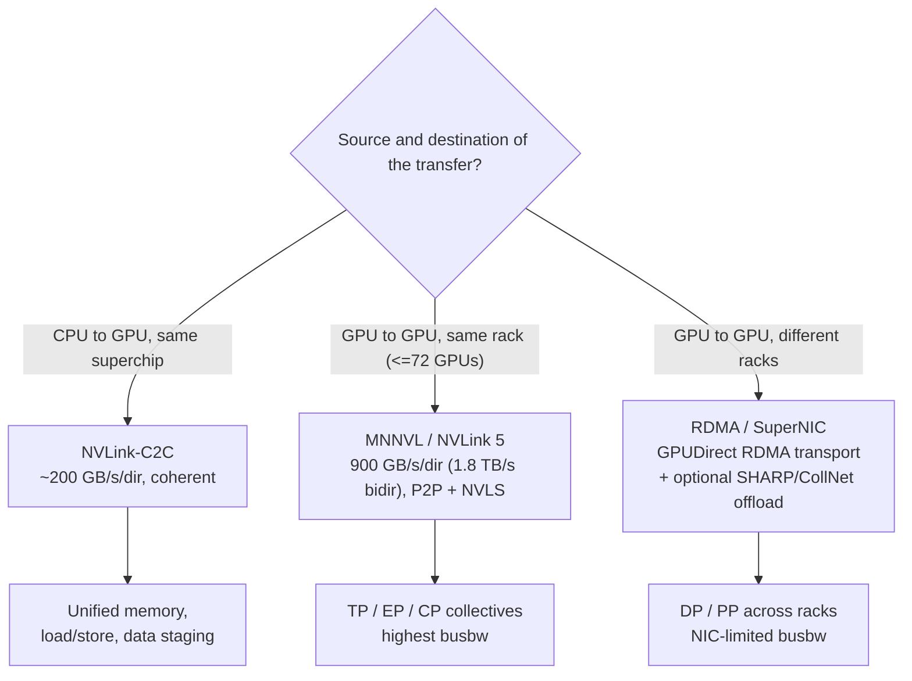

**Rule of thumb:** stay on the fastest fabric the transfer's scope allows. C2C for CPU↔GPU, NVLink for anything inside 72 GPUs, RDMA only when you must leave the rack.

> **TP / EP / CP** — shorthand for the three parallelism dimensions that generate the heaviest in-rack traffic: **T**ensor **P**arallel, **E**xpert **P**arallel (MoE), and **C**ontext **P**arallel (a.k.a. Sequence Parallel / SP). Each maps to a specific collective and fabric; see [Section 10](#10-mapping-fabrics-to-pre-training-parallelism) for the full breakdown.

---

## 8. Diagram 3 — How NCCL selects the transport

NCCL picks the fastest transport **per rank-pair, per collective, per channel**, based on the discovered topology and message size. This is what actually determines which fabric a benchmark exercises.

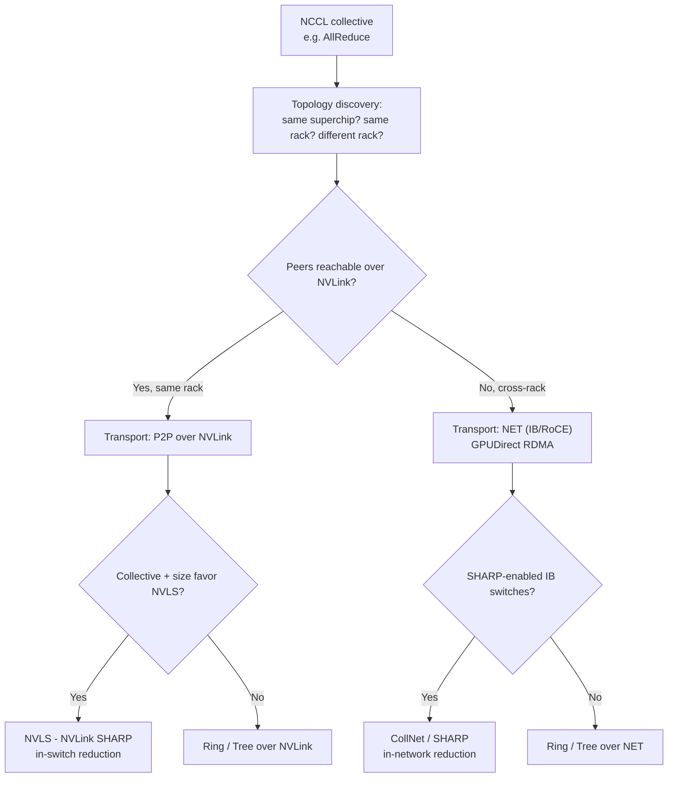

### NCCL transport ↔ fabric mapping

| NCCL transport / algo | Fabric used | Typical use |
|---|---|---|
| **P2P (CUMEM)** | MNNVL / NVLink | Any GPU-GPU pair inside the rack |
| **NVLS** (NVLink SHARP) | MNNVL / NVSwitch | In-rack all-reduce / reduce-scatter / all-gather, large messages |
| **NET + GPUDirect RDMA** | RDMA (IB/RoCE) | Any GPU-GPU pair spanning racks |
| **CollNet / SHARP** | RDMA (IB switch) | Cross-rack all-reduce offloaded into the fabric |
| SHM / host | PCIe/host (avoid) | Fallback when P2P/NET can't be used — usually a misconfig |

**Levers that decide the path:** `NCCL_NVLS_ENABLE`, `NCCL_COLLNET_ENABLE`, `NCCL_IB_HCA` (rail/HCA mapping), `NCCL_P2P_LEVEL`, `NCCL_ALGO`/`NCCL_PROTO`. If an in-rack test drops to `NET` or `SHM`, the topology file or HCA mapping is wrong.

> **Ring vs Tree** — two algorithms NCCL uses to implement collectives when in-network reduction (NVLS/SHARP) is unavailable. A **ring** arranges all GPUs in a logical loop; each GPU passes data only to its neighbor, so every link carries the same load and the *bandwidth cost stays constant regardless of ring size* — but the number of steps (latency) grows linearly with GPU count. A **tree** arranges GPUs in a binary reduction tree; it reaches the root faster than a ring (log N steps vs N steps) and is better for small messages and latency-sensitive collectives, but the root link becomes a bottleneck at scale. NCCL picks between them automatically based on message size and topology.
>
> *In practice NCCL doesn't use a single ring or a single tree.* It builds **multiple concurrent ring channels** to spread traffic across all the links a GPU has, and its tree algorithm is a **double binary tree** — two interleaved trees where a node that is a leaf in one tree is an interior node in the other, so every link is used in both directions and the single-root bottleneck of a plain binary tree disappears. The single-ring / single-tree picture above is the mental model; treat it as the simplification it is.

---

## 9. AllReduce vs AllToAll — collective behavior on the fabrics

> **Not familiar with AllReduce or AllToAll?** See [Section 13](#13-allreduce-and-alltoall-what-they-do-and-why-they-differ) for plain-language definitions of both collectives before reading this section.

The two collectives behave very differently as participant count grows beyond a single rack.

### AllReduce — ring steps are always neighbor-to-neighbor

A ring all-reduce decomposes into reduce-scatter followed by all-gather; each phase advances one step at a time around the ring. The critical property is that each step is **neighbor-only**: GPU_i sends to GPU_{i+1} and receives from GPU_{i-1}. Within a 72-GPU NVLink domain all those neighbors are NVLink peers. Extending the ring across racks adds **one RDMA seam hop per rack the ring spans** (two for the 2-rack case shown below) — regardless of how many GPUs are in the ring. NVLS further offloads the in-rack reduction into the NVSwitch, removing per-GPU round-trips entirely for that phase.

Busbw consequence: in-rack all-reduce runs near NVLink's per-direction line rate (**>900 GB/s** on GB300). Adding racks extends the ring over RDMA at the seam, but the NVLink segments still operate at full NVLink speed; effective busbw degradation is proportional to the fraction of ring steps that traverse RDMA.

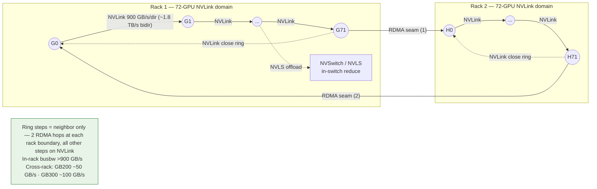

### AllToAll — every rank sends a unique chunk to every other rank (pure P2P)

AllToAll is a complete exchange: each GPU sends one unique chunk to each of the N-1 other GPUs. There is no ring or tree shortcut — each send is an independent, point-to-point transfer. Any pair that spans a rack boundary **must** traverse RDMA; there is no way to route cross-rack all-to-all traffic through NVLink. NVLS cannot help because NVLS offloads *reductions* (sum/max), not arbitrary data movement.

Busbw consequence: the moment the all-to-all domain crosses a rack boundary, every GPU incurs RDMA sends to all 72 GPUs in the far rack. Busbw drops immediately to the NIC-limited plateau — **GB200 ~50 GB/s, GB300 ~100 GB/s** — for the cross-rack fraction. This is why expert-parallel all-to-all must stay inside the 72-GPU NVLink domain (Section 10).

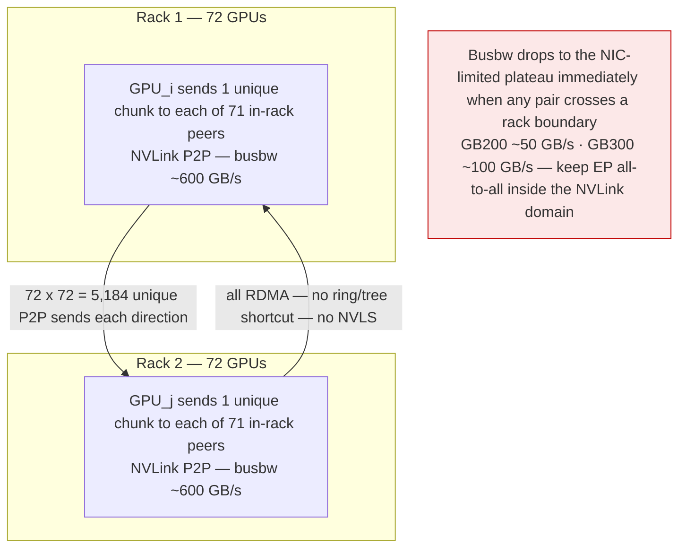

---

## 10. Mapping fabrics to pre-training parallelism

Place the highest-traffic parallelism dimensions on the fastest fabric that can contain them. The general layout on NVL72:

| Parallelism | Traffic pattern | Bytes/step | Preferred fabric | Why |
|---|---|---|---|---|
| **Tensor (TP)** | All-reduce / all-gather every layer | Very high | **MNNVL (in-rack)** | Most bandwidth-sensitive; keep inside 72-GPU domain |
| **Expert (EP)** | All-to-all (MoE dispatch/combine) | Very high, bursty | **MNNVL (in-rack)** | All-to-all punishes slow links; needs NVLink |
| **Context / Sequence (CP)** | P2P / all-gather of K,V | High | **MNNVL (in-rack)** | Latency-sensitive, large tensors |
| **Pipeline (PP)** | P2P activations between stages | Moderate | **RDMA (cross-rack)** | Point-to-point, tolerant of lower BW |
| **Data (DP / FSDP)** | Gradient all-reduce / reduce-scatter | High but once/step | **RDMA (cross-rack)**, SHARP-offloaded | Overlaps with compute; SHARP hides latency |

**Design heuristic:** size **TP × EP × CP ≤ 72** so the heaviest collectives stay on NVLink; let **DP** and **PP** span racks over RDMA where the lower per-GPU bandwidth hurts least — roughly **9× (GB300) to 18× (GB200)** below in-rack, on an all-reduce busbw basis (>900 GB/s ÷ 100/50 GB/s NIC). C2C sits underneath all of this, feeding data and offloading state between Grace and Blackwell — but at only **~200 GB/s/direction**, so CPU offload (optimizer state, activation/KV spill to Grace) is a real bottleneck, not free capacity. Size offload so the per-step bytes moved over C2C stay well under that ceiling.

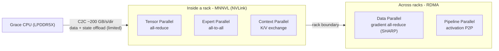

---

## 11. GB200 vs GB300 — what changes for data flows

| Attribute | GB200 NVL72 | GB300 NVL72 | Impact on data paths |
|---|---|---|---|
| GPU | Blackwell (B200-class) | Blackwell Ultra (B300) | More FP4/FP8 compute → higher demand on all fabrics |
| HBM per GPU | ~192 GB HBM3e | **288 GB HBM3e** (20.7 TB/rack) | More KV-cache / activations resident → less C2C/RDMA spill |
| **NVLink-C2C** | ~200 GB/s/dir per GPU | **~200 GB/s/dir per GPU** (measured) | Unchanged — CPU-mediated device↔host link |
| **MNNVL (NVLink 5)** | >900 GB/s all-reduce / ~600 GB/s all-to-all (NCCL busBW) | Same | Unchanged — same in-rack scale-up |
| **Scale-out NIC** | ConnectX-7, **400 Gb/s** per GPU | ConnectX-8 SuperNIC, **800 Gb/s** per GPU | **2× cross-rack bandwidth** → DP/PP scale-out roughly halves the NVLink:RDMA gap (all-reduce busbw basis: 18× → 9×) |
| Scale-out fabric | Quantum-2 IB / Spectrum-X | Quantum-X800 IB / Spectrum-X | Higher spine bandwidth, same rail-optimized model |

**Takeaway:** the scale-up story (C2C + MNNVL) is identical across generations. The generational change is **scale-out**: GB300's ConnectX-8 doubles per-GPU RDMA bandwidth, which relaxes how tightly you must confine DP/PP and improves multi-rack collective efficiency.

---

## 12. Benchmarking cheat-sheet (NCCL)

| Test / scope | Fabric exercised | Reference ceiling | What to confirm |
|---|---|---|---|
| `all_reduce_perf`, 2–72 GPUs, 1 rack | MNNVL (NVLS) | GB300 busbw **>900 GB/s** target | NVLS engaged (`NCCL_NVLS_ENABLE=1`), no NET/SHM fallback |
| `alltoall_perf`, 1 rack | MNNVL | GB300 busbw **~600 GB/s** target | All pairs on P2P/NVLink |
| host↔device BW test (`nvbandwidth`) | **C2C** | **~200 GB/s per direction** (C2C link — a separate path from the NVLink GPU-to-GPU fabric) | Confirm traffic is on C2C, not PCIe; `NCCL_P2P_LEVEL` determines whether NCCL uses the P2P/C2C path for host↔device transfers |
| `all_reduce_perf`, multi-rack | RDMA (+ SHARP/CollNet) | Scale-out busbw plateau near single-NIC SOL: GB200 ~50 GB/s, GB300 ~100 GB/s per GPU | GB300: CX8 is directly connected to Blackwell — GPUDirect RDMA, true HBM access. GB200: path is GPU → C2C → Grace crossbar → PCIe → CX7; CX7 does not support GPUDirect RDMA. Verify rail/HCA mapping, CollNet if SHARP. |
| `sendrecv_perf`, cross-rack | RDMA | NIC line rate | GB300 (CX8): direct GPU↔NIC path. GB200 (CX7): indirect C2C→crossbar→PCIe path — no GPUDirect RDMA. |

Reference GB300 measured values <!-- INTERNAL_START -->(NVIDIA Internal, per GPU)<!-- INTERNAL_END --> — tools noted: HBM STREAM Triad **>7,000 GB/s** (STREAM) · C2C **~200 GB/s per direction** (`nvbandwidth`) · NCCL all-reduce busBW **>900 GB/s** (NCCL Tests AllReduce) · NCCL all-to-all busBW **~600 GB/s** (NCCL Tests AlltoAll).

**AlgBW vs BusBW — and why busBW can exceed line rate.**

NCCL tests report two bandwidth figures for every collective:

- **AlgBW (algorithm bandwidth):** `message_size / time`. This is the raw throughput from the application's perspective — how fast was data moved, end-to-end, relative to the message the caller passed in.
- **BusBW (bus bandwidth):** `AlgBW × correction_factor`. NCCL multiplies AlgBW by a collective-specific factor derived from the ideal ring algorithm cost to normalize across GPU count and collective type, making numbers comparable. For all-reduce the factor is `2(N−1)/N`; for all-to-all it is `(N−1)/N`. As N grows these factors approach 2 and 1 respectively.

**Why BusBW can exceed NVLink's nominal 900 GB/s per-direction line rate** when NVLS (NVLink SHARP) is engaged: the BusBW formula was designed for ring algorithms, where data traverses every link in both directions. NVLS is not a ring — the NVSwitch performs the reduction in-network, so data is aggregated *inside the switch fabric* without flowing all the way around the ring. The effective data movement the GPUs see is lower than what a ring would require, yet NCCL applies the same ring-derived multiplier. The result is a BusBW number that can appear to exceed the physical link's 900 GB/s per-direction line rate (the link is 1.8 TB/s bidirectional on GB200/GB300). This is not a measurement error or an indication of data moving faster than the hardware allows — it is a known artifact of applying a ring correction factor to a non-ring (in-network reduction) algorithm. AlgBW remains the honest end-to-end throughput figure. When you see BusBW **>900 GB/s** on an all-reduce test with NVLS enabled, the correct interpretation is: *NVLS is working, and the collective completed faster than a ring would have at that GPU count.*

**Interpreting results:** a healthy multi-rack all-reduce shows a clear two-tier profile — near-NVLink busbw (~900+ GB/s) while the message stays in-rack, dropping to NIC-limited busbw (GB300 ~100 GB/s) once it crosses racks. If in-rack numbers look NIC-limited, the topology/HCA mapping is forcing NET; if cross-rack numbers are worse than the NIC's busbw plateau, check GPUDirect RDMA, rail mapping, and congestion control. For NVLink-domain testing, don't assume `NCCL_NVLS_ENABLE=1 NCCL_MNNVL_ENABLE=1` must both be forced — NCCL auto-detects the NVLink domain and selects NVLS/MNNVL accordingly <!-- INTERNAL_START -->(NVIDIA Internal GB300 runs use `NCCL_MNNVL_ENABLE=1` with `NCCL_NVLS_ENABLE=0` in some cases)<!-- INTERNAL_END -->. Verify NCCL *selected* NVLS/MNNVL as intended rather than hard-coding the pair. Separately, a straggler on any one of the 4 CX8 rails throttles the whole cross-rack collective.

---

## 13. AllReduce and AllToAll — what they do and why they differ

### AllReduce in one sentence
Every participant contributes a **same-shape tensor**; every participant receives the **element-wise sum** (or mean) of all contributions. There is no "who sends to whom" problem because the operation is symmetric: the output is the same for everyone.

**Where it appears in training:**
- **Tensor parallelism (TP):** a matrix multiply is sharded across GPUs column- or row-wise. Each GPU computes a partial output; an all-reduce sums the partial results so every GPU holds the full activation. Fires *every layer, every forward and backward pass*.
- **Data parallelism (DP / FSDP / ZeRO):** each rank trains on a different micro-batch and accumulates local gradients. An all-reduce (or reduce-scatter + all-gather for FSDP) synchronizes gradients across ranks before the optimizer step. Fires *once per step, after the backward pass*.
- **Sequence / context parallelism (CP):** query/key/value tensors split along the sequence dimension need to be reassembled for attention; all-gather and reduce-scatter collectives re-form the full sequence.

**Why it is bandwidth-efficient on NVLink:** the ring reduce-scatter + all-gather decomposition means each GPU only ever exchanges data with its two ring neighbors. Inside a 72-GPU NVLink domain those neighbors are always NVLink peers, and NVLS (NVLink SHARP) can offload the reduction entirely into the NVSwitch — removing per-GPU round-trips. Measured all-reduce busbw on GB300 reaches **>900 GB/s**.

### AllToAll in one sentence
Every participant sends a **unique chunk** to every other participant and receives a **unique chunk** from every other participant. There is no aggregation — each destination gets different data from each source, and the full N×N exchange must complete before any GPU can proceed.

**Where it appears in training:**
- **Expert dispatch (MoE):** after routing, GPU_i sends token-chunks to whichever GPUs own each token's assigned expert. GPU_j receives a completely different set of tokens than GPU_k. This is the canonical AllToAll workload.
- **Expert combine (MoE):** after expert compute, each GPU returns the processed tokens to their originating GPUs. Another AllToAll, same traffic pattern in the reverse direction.
- **Sequence parallelism variants** that rearrange KV heads across ranks also use AllToAll.

**Why AllToAll punishes fabric boundaries:** there is no ring/tree shortcut. Any pair (i, j) that spans a rack boundary *must* traverse RDMA, and every GPU incurs RDMA sends to all 72 GPUs in each far rack simultaneously. Busbw drops instantly to the NIC-limited plateau (~50 GB/s GB200, ~100 GB/s GB300) for the cross-rack fraction. Keeping all-to-all inside the 72-GPU NVLink domain is not a soft preference — it is a hard performance requirement for MoE at scale.

---

## 14. Mixture of Experts — basics and the AllToAll requirement

### What MoE is

A standard transformer FFN applies the same feed-forward network to every token. A **Mixture of Experts (MoE)** replaces that single FFN with **N expert sub-networks** (typically N = 8 to 256) and a lightweight **router** (a small linear layer + softmax). For each token the router selects the **top-K experts** (K ranges from 1–2 in older models like Mixtral up to 8 in DeepSeek-V3) that will process it. Only K/N of the experts fire per token, so FLOPs/token stays roughly constant even as total parameter count grows by ~N×.

**Why it matters for NVL72:** DeepSeek-V3/R1, Mixtral, and the next generation of large production models are all MoE. Expert parallelism (EP) — where each GPU owns a subset of experts — is the dominant new parallelism dimension on these systems, and it introduces an AllToAll on every FFN layer.

### The four phases of one MoE FFN layer

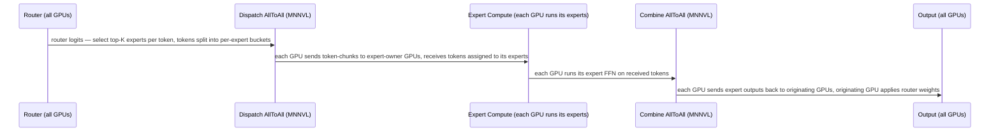

1. **Route:** the router scores each token against all N experts; top-K winners are selected. This is local compute — no communication yet.
2. **Dispatch AllToAll:** GPU_i partitions its tokens into N buckets (one per expert owner) and performs a global AllToAll. GPU_j now holds all tokens assigned to its experts, from all GPUs.
3. **Expert compute:** each GPU runs its local expert FFN on the received token batch. This is the compute-heavy phase — the whole point of MoE.
4. **Combine AllToAll:** each GPU sends computed expert outputs back to the GPUs that originated those tokens. The receiving GPUs apply router gate weights and sum the K expert contributions into the final FFN output.

**Communication volume per layer per GPU (rough):**  
`tokens_per_gpu × hidden_dim × K × 2 bytes (FP16) × 2 (dispatch + combine)` — each token is sent to its K experts and its outputs returned; the send volume scales with K (how many experts each token hits), not 1/N. For large models this is hundreds of GB/s of required fabric bandwidth — which is exactly why it must stay on NVLink.

### Why AllReduce does not apply to MoE dispatch

AllReduce works when every GPU contributes to the same output. In MoE dispatch, GPU_i's tokens go to GPU_j, GPU_k, GPU_l — not to all GPUs equally. GPU_m receives a completely different set of tokens than GPU_j. There is no common tensor to sum; the exchange is a permutation, not a reduction. AllToAll is the only collective that expresses this correctly.

### Expert parallelism sizing constraint

With N total experts and EP degree `ep`, each GPU owns `N / ep` experts. A popular configuration on NVL72: EP=72 (one expert per GPU, or a small multiple). The 72-GPU NVLink domain then handles the full AllToAll on NVLink at ~600 GB/s busbw. Crossing the rack boundary drops that to ~100 GB/s — a 6× penalty. **Size EP ≤ 72 and keep it inside one NVLink domain.**

---

## 15. C2C H2D and D2H in the training and inference loop

Section 4 established the bandwidth ceiling (~200 GB/s per direction). This section explains *where* that ceiling becomes a binding constraint in practice.

### One training step, annotated by fabric

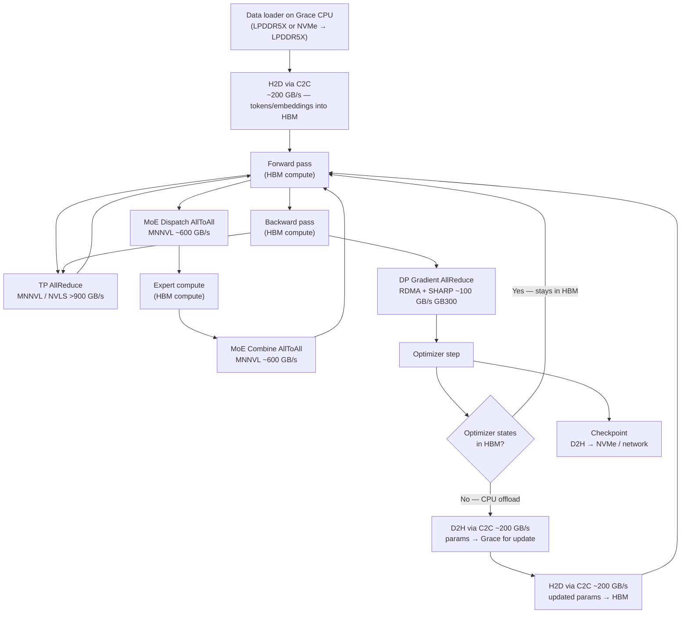

### C2C is on the critical path in three specific situations

#### 1. Data ingestion (H2D)

The Grace CPU runs the data pipeline: tokenization, shuffling, sequence packing. Staged batches live in LPDDR5X and move H2D across C2C into HBM before the forward pass. At ~200 GB/s you can transfer ~200 GB of input data per second — sufficient for most sequence lengths at typical batch sizes, but a real ceiling for high-throughput inference prefill with very long contexts or for workloads that keep the pipeline CPU-bound.

**What to watch:** if GPU utilization shows idle gaps between steps, profile whether the data loader is CPU-bound or C2C-bound. Overlapping H2D transfers with the backward pass (double-buffering on the Grace side) is the standard mitigation.

#### 2. CPU optimizer state offload (D2H → compute → H2D)

For very large models, Adam's two moment tensors (first and second moment, FP32) cost ~2× the parameter memory. A 70B-parameter model has ~560 GB of optimizer state at FP32 — far beyond a single GPU's 288 GB HBM3e. Solutions like ZeRO-3 (sharded optimizer), DeepSpeed CPU offload, or Megatron's distributed optimizer can move optimizer states to Grace LPDDR5X.

At the optimizer step:
1. Gradients (or sharded gradients) flow **D2H** to Grace — up to ~200 GB/s.
2. The Grace CPU (or Grace GPU tensor cores in a compute-offload variant) updates the moment estimates and applies the weight update.
3. Updated parameters flow **H2D** back to HBM — up to ~200 GB/s.

This round-trip is **directly on the step-time critical path** if it is not overlapped. Note what actually crosses C2C: the FP32 moments (~560 GB for a 70B model) stay **resident in Grace LPDDR5X** and are updated in place by the CPU — they do *not* traverse the link each step. What crosses is **gradients D2H + updated parameters H2D** — ~280 GB for a 70B FP16 model — taking **~1.3–1.5 seconds** of pure transfer time per step (before any compute). Overlap with the backward pass is essential; if the optimizer update cannot be fully hidden, C2C becomes the step-time bottleneck, not GPU compute.

**Key check:** measure step time with CPU offload on vs. off. If step time grows by more than the backward pass duration, optimizer D2H/H2D is not fully overlapped.

#### 3. KV-cache spill in inference (D2H / H2D)

For long-context inference (e.g., 128K–1M token contexts), the KV-cache for all in-flight sequences can exhaust HBM. Systems like vLLM and TensorRT-LLM support **KV-cache offload**: spilling cold KV blocks to Grace LPDDR5X (D2H at ~200 GB/s) and reloading them on the decode step that needs them (H2D at ~200 GB/s).

At ~200 GB/s/direction, reloading a 16 GB KV-cache block takes **~80 ms** — a meaningful fraction of a decode step. The correct mental model is: Grace LPDDR5X is a **slower HBM extension**, not free capacity. Use it to extend context length when HBM is the hard constraint, but size the hot/cold ratio so the reload latency stays below the acceptable decode SLA.

**GB300 advantage:** 288 GB HBM3e per GPU (vs ~192 GB GB200) means KV-cache spill happens at a much higher context length before HBM pressure — spill to Grace is less often needed, so the C2C ceiling is hit less frequently.

### Sizing heuristic: how much C2C budget does a step consume?

| Traffic source | Direction | Rough size (70B dense, BS=1) | Time at 200 GB/s |
|---|---|---|---|
| Token embedding lookup (H2D) | H2D | ~KB range | negligible |
| Activation checkpointing (store) | D2H | 1–10 GB/layer (model-dependent) | 5–50 ms/layer |
| Optimizer state update (ZeRO-3) | D2H + H2D | ~280 GB (grad↓ + param↑; moments stay resident on Grace) | ~1.4 s round-trip |
| KV-cache spill/reload (long ctx) | D2H + H2D | GB-scale per eviction | 10–100 ms/eviction |
| Checkpoint save | D2H | ~140 GB params (FP16) | ~720 ms |

The optimizer state row dominates training; the KV-cache row dominates inference. Both must be overlapped with compute or they set the step time floor.

---

<!-- INTERNAL_START -->
**NVIDIA Internal (measured benchmark data — the basis for all "measured" figures above):**

- [GB300 Performance Benchmarking — NVIDIA Internal (Confluence)](https://nvidia.atlassian.net/wiki/spaces/3P/pages/2075773370/GB300+Performance+Benchmarking) — C2C ~200 GB/s/dir, NCCL all-reduce >900 GB/s, all-to-all ~600 GB/s, STREAM Triad >7,000 GB/s.
- [NCCL Collective Behavior and Performance GB300 — NVIDIA Internal (Google Drive)](https://drive.google.com/file/d/1pbf0_x67wIK7MqkKRIamLQjq4OyoARd0/view) — rail-optimized NCCL path behavior; ~900 GB/s NVLink vs ~100 GB/s NIC bus-bandwidth constants.
<!-- INTERNAL_END -->

**Public (architecture and theoretical specs):**

- [GB200 NVL72 — NVIDIA](https://www.nvidia.com/en-us/data-center/gb200-nvl72/)
- [GB300 NVL72 — NVIDIA](https://www.nvidia.com/en-us/data-center/gb300-nvl72/)
- [NVIDIA GB200 NVL72 Delivers Trillion-Parameter LLM Training and Real-Time Inference — NVIDIA Technical Blog](https://developer.nvidia.com/blog/nvidia-gb200-nvl72-delivers-trillion-parameter-llm-training-and-real-time-inference/)
- [System Hardware & Components — NVIDIA NVL72 AI Factory (docs.nvidia.com)](https://docs.nvidia.com/enterprise-reference-architectures/nvl72-ai-factory/latest/components.html)
- [NVIDIA GB200 NVL Multi-Node Tuning Guide — NCCL (docs.nvidia.com)](https://docs.nvidia.com/multi-node-nvlink-systems/multi-node-tuning-guide/nccl.html)
- [Enabling Fast Inference and Resilient Training with NCCL 2.27 — NVIDIA Technical Blog](https://developer.nvidia.com/blog/enabling-fast-inference-and-resilient-training-with-nccl-2-27/)
- [DGX SuperPOD Reference Architecture for GB200 (docs.nvidia.com)](https://docs.nvidia.com/dgx-superpod/reference-architecture-scalable-infrastructure-gb200/latest/)
- [About GB200 and GB300 NVL72-powered instances — CoreWeave Docs](https://docs.coreweave.com/platform/instances/nvl72)
