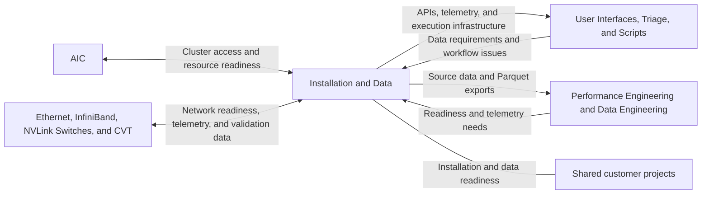
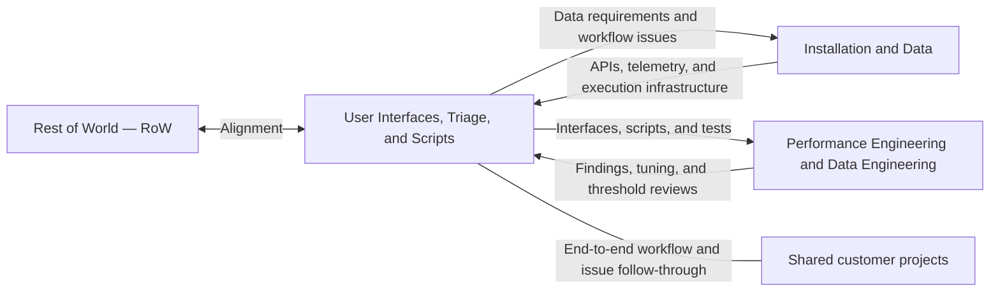
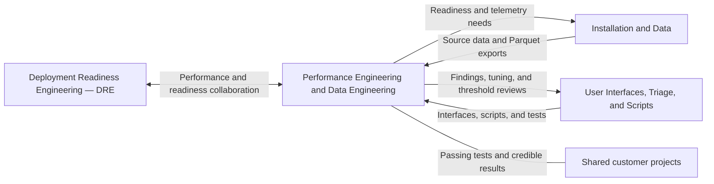

# Team Ownership and Interfaces

All projects and documentation are moving into the **CMODS** monorepo. Everyone owns documentation and can contribute across team boundaries; ownership establishes accountability and required reviews.

| Team | Owns |
|---|---|
| **Installation and Data** | Cluster installation and readiness; database and API availability; telemetry collection and stores; Rack Status API and data sources; Auto Action Trigger installation and operation; NVIS P2P and distribution of testing assets. |
| **Interfaces** (User Interfaces, Triage, and Scripts) | End-to-end workflow health: observability works, conformance is followed, agents run, and issues get resolved by their action owners. Grafana dashboards, Rack Status WebUI, shared test implementations and workflows, triage automation, and CLIs/WebUIs/MCPs. **CMODS CI/CD for software and documentation**, including checks, builds, releases, deployment, and publishing. |
| **Performance Engineering and Data Engineering** | Ensuring tests pass and numbers make sense; performance investigations, tuning recommendations, and validation; experiments when capacity allows; data lake ingestion and analysis; reusable analysis methods, notebooks, charts, and findings. |

# Overall Leads

## Description

Working across projects, the overall leads are expected to have an overall idea of how everything works together. They will be the best point of contact for questions on scheduling and resolving technical questions, either by knowing the answer or knowing where to go to get the answer.

Expect the overall leads to have the area they are the SME in.

## Who

- Travis Drake
- Harish Lakshminarasimhan
- Rafael Marcelino Koike

# Project Streams -- Teams and Descriptions

We are using [Team Topologies](https://itrevolution.com/wp-content/uploads/2022/06/TTOP_audio-excerpt_072419_r1.pdf) to organize three teams around the streams below. Working on Projects is the fourth stream, shared by everyone. People can work on specific tools and move between streams as we learn what each project requires.

We will aim to have someone from each of the three streams on every customer project. We will adjust responsibilities and boundaries as the work develops.

Team calls will be organized around these streams. The aim is to make responsibilities and review boundaries clear, collaborate where needed, and develop services that other streams can consume in the workflow. These boundaries trigger reviews and identify who is accountable; they are not strict firewalls around where people can work.

People are listed under each stream’s “Who?” section. For projects shared across streams, each project entry describes that stream’s responsibility. All projects support the shared Working on Projects stream.

## What Ownership Means

Throughout this document, **ownership means a stream is responsible for the outcomes and review of its area**. The owning stream makes sure the area meets its users' needs, coordinates decisions and dependencies, reviews relevant changes, and follows through on issues and improvements. It is the point of contact when the outcome needs attention.

Ownership does not mean that only members of that stream can do the work. Anyone on the team can contribute implementation, fixes, documentation, or operational work, including with AI assistance. The owning stream remains responsible for reviewing relevant contributions and ensuring the outcome works; contributors and other affected streams remain responsible for collaborating and bringing their expertise to the work. For shared projects, each stream owns the outcomes and reviews within its stated scope, and the streams coordinate changes that cross those boundaries.

Working on Projects remains a responsibility shared by everyone. Stream ownership supports that work; it does not remove the project team's responsibility to run tests and perform initial triage.

Documentation is owned by everyone. All streams are responsible for keeping documentation accurate and current as they contribute and make changes, with subject-matter review from the affected streams. User Interfaces, Triage, and Scripts owns the CMODS CI/CD process for both documentation and software.

CMODS will be our single source of truth for all projects and documentation, easy for people to update and supported by a known end-to-end process. The shared workflow should make it clear how to propose a change, which reviews it needs, how it is validated and put into use, and who follows through on outstanding actions. Keep the process, ownership, and action status documented alongside the shared work so people can contribute with minimal friction.

During each project, the streams are accountable for the following outcomes:

- **Installation and Data:** the installation works, and the databases and APIs needed by the project are available.
- **User Interfaces, Triage, and Scripts (Interfaces):** the workflow works end to end: observability is working, conformance is being followed, agents are running, and identified issues are actually getting fixed. This stream coordinates follow-through with the responsible owners; it does not own implementing every fix.
- **Performance Engineering and Data Engineering:** tests are passing and the reported numbers make sense. When project capacity allows, this stream also runs experiments to improve performance or gather data that deepens our understanding.

Each stream owns understanding its part of the workflow and ensuring its specific actions are completed. Track issues with an explicit action owner and verify resolution across the workflow. Anyone may contribute across these areas, with the affected streams providing the required reviews.

## CMODS Monorepo and Review Ownership

We are moving all projects and documentation into one monorepo named **CMODS**. This includes NVIS Rack Status, Auto Action Trigger, NVIS P2P, observability, data lake tooling, analysis code and notebooks, test workflows, and team and project documentation, including this team map. New projects and their documentation will also live in CMODS.

CMODS will organize these areas into clear directories, with documentation maintained alongside the work it describes. Documentation ownership is shared by everyone, and affected streams provide subject-matter reviews for both code and documentation. User Interfaces, Triage, and Scripts owns the repository's CI/CD process for software and documentation, including automated checks, builds, releases, deployment, and documentation publishing. Components can retain independent build, release, and deployment paths within the monorepo. Migrate existing projects and documentation into CMODS incrementally, verifying behavior and updating references as each area moves.

Each area has a primary owning stream responsible for its outcomes and review. GitLab directory ownership and merge request approval rules should require review from the responsible stream for changes in its area. Changes across areas need review from each affected stream. Installation and Data reviews changes to API contracts and source-data schemas; the consuming streams also review changes that affect their use. Ownership rules must cover contracts and schemas wherever they live, not just files in an API directory. Verify that GitLab approval settings enforce the intended reviews, including for changes spanning multiple areas. AI-assisted changes follow the same review process.

Installation and Data owns the versioned source-data API and its contract. User Interfaces, Triage, and Scripts and Performance Engineering and Data Engineering are consumers and help define their data and compatibility requirements. Maintain compatibility and migration guidance for API changes because components and consumers may be deployed on different schedules. Performance Engineering and Data Engineering continues to own data lake ingestion and analysis.

Shared validation checks, benchmark implementations, and their verdict rules should have one canonical source in CMODS, used by Auto Action Trigger and surfaced by Rack Status. User Interfaces, Triage, and Scripts owns test content and workflows; Installation and Data owns cluster-side installation, operation, and execution infrastructure. Performance Engineering and Data Engineering reviews test thresholds and interpretation where relevant. Rack Status may retain operator workflows while using the shared tests and results through a supported interface.

Migrate tests incrementally: inventory and compare existing checks, preserve distinct platform and multi-node capabilities, and verify equivalent behavior and results on representative hardware before retiring duplicates. Preserve site-specific baselines and verdict semantics. Define a supported interface for requesting runs and obtaining status, verdicts, and evidence; existing filesystem and reporting-script integrations remain until a replacement is ready.

## Working on Projects -- Testing, Validation, and Benchmarking

### Description

This is our main job and we will all be doing doing it. As things evolve, we will be ensuring that tests are running and doing any initial triage on what can be fixed or done to make them go more smoothly. Sometimes, things will be fully automated, but when they aren't we need to work with each on the team assigned to the project to ensure that tests run smoothly and we are getting the results we expect. This will involve understanding the basics of Slurm, our tests, what system state should look like, and the tools we build.

### Who?

**Everyone**

### Tools

The whole stack

## Installation and Data

### Team interactions

### Description

This stream is responsible for the outcomes and review of cluster bring-up and making data available for other teams. During a project, you own installation and ensuring that the required databases and APIs are available. This will be a cross functional team that has to work with teams such as Ethernet, InfiniBand, and NVLink Switches in order to get OpenTelemetry and other data available for teams to consume. You will be the vanguard on making sure the cluster is ready for us to begin testing on and you will collaborate with the AIC team to ensure everyone else can login and we have enough resources (space on filesystem, CPUs, RAM, and network.)

#### Project Responsibility

- You will own telemetry collection, Prometheus, and Victoria Metrics, and provide data for Grafana dashboards owned by User Interfaces, Triage, and Scripts.
- You will own the NVIS Rack Status API and data sources. User Interfaces, Triage, and Scripts owns the WebUI. The API and WebUI will live in CMODS with directory-level review ownership.
  - Auto Action Trigger results are available through existing filesystem and reporting-script integration; a supported interface for runs and results is a target for CMODS.
- You will own getting Auto Action Trigger installed and running on the cluster and making its results available. User Interfaces, Triage, and Scripts owns the tests and conformance testing (formerly health checks) that it runs.
- You will own NVIS P2P and distribution of containers and other files needed for testing.
- You will collaborate across NVIS, including functions such as CVT, to make the data needed for validation available.
- You will provide source data and consistent API access for interfaces and analysis. Performance Engineering and Data Engineering owns ingestion into the data lake using Parquet files exported from the cluster, along with the data lake and analysis built from it.
- This stream provides consistent API access to cluster data and supports the source-data handoff for Parquet-based data lake ingestion.

### Who?

- Harish Lakshminarasimhan
- Michael Echavarria
- Michelle Ramirez

### Tools and Capabilities

- Telemetry consumed for Observability
  - Data stores
    - Prometheus
    - Victoria Metrics
  - API for access consistency
- NVIS Rack Status - API and data sources
- Auto Action Trigger
- NVIS P2P

### Projects

- **NVIS Rack Status** — own the API and data sources; the API and WebUI will live in CMODS with separate review owners.
- **Observability** — collect telemetry and operate Prometheus and Victoria Metrics for downstream visualization and analysis.
- **Auto Action Trigger** — own installation and operation on the cluster and make test results available; User Interfaces, Triage, and Scripts owns the tests and conformance testing it runs.
- **NVIS P2P** — distribute containers and other files needed for testing.

### Interactions with Other Streams

- Provide APIs and data consumed by User Interfaces, Triage, and Scripts; incorporate feedback on data access and completeness.
- Provide source data for Performance Engineering and Data Engineering, which owns data lake ingestion using Parquet files exported from the cluster; collaborate on network readiness, telemetry, and data needed for performance investigations and cross-project analysis.
- Collaborate with AIC and across NVIS, including Ethernet, InfiniBand, NVLink Switches, and CVT, on cluster readiness and data availability.
- Support Working on Projects by ensuring the cluster and data are ready for testing and resolving readiness, installation, and data availability issues identified during initial triage.

## User Interfaces, Triage, and Scripts

### Team interactions

### Description

This stream is responsible for the outcomes and review of the interfaces, tests, and triage automation we use in our work. You will own the tests, conformance testing (formerly health checks), and scripts that automate triage. You will select and maintain test workflows, incorporating performance findings from Performance Engineering and Data Engineering. You will use the APIs and data provided by Installation and Data to deliver interfaces, scripts, and tests for project teams and Performance Engineering and Data Engineering.

During a project, this stream is accountable for ensuring the workflow works end to end. That includes checking that observability is working, conformance is being followed, agents are running, and issues are being resolved by their action owners. Coordinating and verifying resolution does not make this stream responsible for implementing every fix.

#### Project Responsibility

- You will own Grafana dashboards and the visualization of telemetry provided by Installation and Data.
- You will own the NVIS Rack Status WebUI and consume the API provided by Installation and Data.
- You will build and maintain scripts that automate triage and help the team run the right tests.
- You will own test implementation, selection, and configuration, including conformance testing. You will incorporate tuning recommendations and performance validation from Performance Engineering and Data Engineering.
- Shared tests and verdict rules have one canonical source in CMODS and are used by Auto Action Trigger and Rack Status. This stream owns test content regardless of execution infrastructure.
- You will own and maintain CMODS CI/CD for software and documentation, including automated checks, builds, releases, deployment, and documentation publishing. Everyone owns documentation content and contributes updates, with reviews from the affected streams.
- This stream ends in user interfaces, including CLIs, WebUIs, and MCPs.

### Who?

- Travis Drake
- Yugandhar Khair
- Dejaun Gayle

### Tools and Capabilities

- Grafana
- NVIS Rack Status - WebUI
- CMODS CI/CD for software and documentation
- Tests and conformance workflows run by Auto Action Trigger
- CLIs, WebUIs, and MCPs for validation workflows
- Triage automation scripts and test workflows

### Projects

- **NVIS Rack Status** — own the WebUI and consume the API provided by Installation and Data; the API and WebUI will live in CMODS with separate review owners.
- **Observability** — own Grafana dashboards and visualization of telemetry provided by Installation and Data.
- **CMODS CI/CD** — own the repository's CI/CD process for software and documentation, including automated checks, builds, releases, deployment, and documentation publishing. Documentation content is owned by everyone.
- **Tests and Conformance** — own tests, conformance testing, test selection and configuration, and triage automation, including workflows run by Auto Action Trigger. Shared test implementations and verdict rules have one canonical source in CMODS.

### Interactions with Other Streams

- Consume the API and data service provided by Installation and Data.
- Provide interfaces, scripts, and tests to Performance Engineering and Data Engineering; incorporate its findings into test selection, configuration, and triage automation.
- Support Working on Projects with interfaces for running tests, reviewing results, and performing initial triage. Project teams perform initial triage; this stream tracks issues across the end-to-end workflow, coordinates with the responsible action owners, and verifies that fixes restore the workflow. It owns outcomes and review within its area, while implementation of fixes can involve any stream.
- Collaborate with Rest of World (RoW) to ensure alignment.

## Performance Engineering and Data Engineering

### Team interactions

### Description

This stream is responsible for the outcomes and review of performance engineering, data engineering, and cross-project analysis, including learning where to focus fixes and how to tune systems and test configurations to meet expected performance. You will be the primary source of help for understanding tests that run but produce low performance. You will turn results into evidence that supports decisions during customer engagements and builds our understanding across projects.

During a project, this stream is accountable for ensuring tests are passing and the reported numbers make sense, working with the project team and the owners of any required fixes. When project capacity allows, you will also experiment to improve performance or gather useful data.

#### Project Responsibility

- You will investigate low performance and help the project team understand what the test results mean during a customer engagement.
- You will identify where to focus fixes, recommend system and test configuration changes, and validate their performance impact. User Interfaces, Triage, and Scripts is responsible for the outcomes and review of changes to shared tests and workflows; members of any stream may contribute those changes.
- You will own the NVIS Data Lake, ingestion into it using Parquet files exported from the cluster, and cross-project analysis. Installation and Data provides the source data and consistent API access for cluster workflows.
- You will develop documented analysis methods and reusable sample functions for working with data on the cluster and in the data lake.
- You will produce charts, Jupyter notebooks, decisions during engagements, and whitepapers that explain findings and guide future work.
- This stream ends in a data lake and the analysis and decisions built from it.

### Who?

- Tyler Race
- Rafael Marcelino Koike
- Alyssa Sawyer
- Bryan Reese (Temporary)

### Tools and Capabilities

- NVIS Data Lake
- Parquet files exported from the cluster for data lake ingestion
- Charts and Jupyter notebooks
- NCCL, LLM Debug, and Network Performance expertise within the stream
- Interfaces, scripts, and tests provided by User Interfaces, Triage, and Scripts

### Projects

- **NVIS Data Lake** — own ingestion of Parquet files exported from the cluster and the data lake used for cross-project analysis and comparison.
- **Documented Analysis and Sample Functions** — produce repeatable analysis methods, example notebooks, and reusable functions for cluster and data lake analysis beyond Grafana dashboards.

#### Skill Areas We Need to Scale

- **NCCL** — performance expertise and collaboration with User Interfaces, Triage, and Scripts on test selection and tuning.
- **LLM Debug** — investigation of workload behavior and low performance during projects.
- **Network Performance** — performance investigations and collaboration with Installation and Data on network readiness or telemetry.

### Interactions with Other Streams

- Consume interfaces, scripts, and tests provided by User Interfaces, Triage, and Scripts; return findings and tuning recommendations to improve test selection, configuration, and triage automation.
- Ingest Parquet files exported from the cluster into the data lake, using source data provided by Installation and Data; collaborate on network readiness, telemetry, and data needed for performance investigations and cross-project analysis.
- Support Working on Projects with performance investigations and decisions during engagements. Project teams perform initial triage and bring tests that run but produce low performance to this stream for deeper investigation.
- Collaborate with Deployment Readiness Engineering (DRE).
